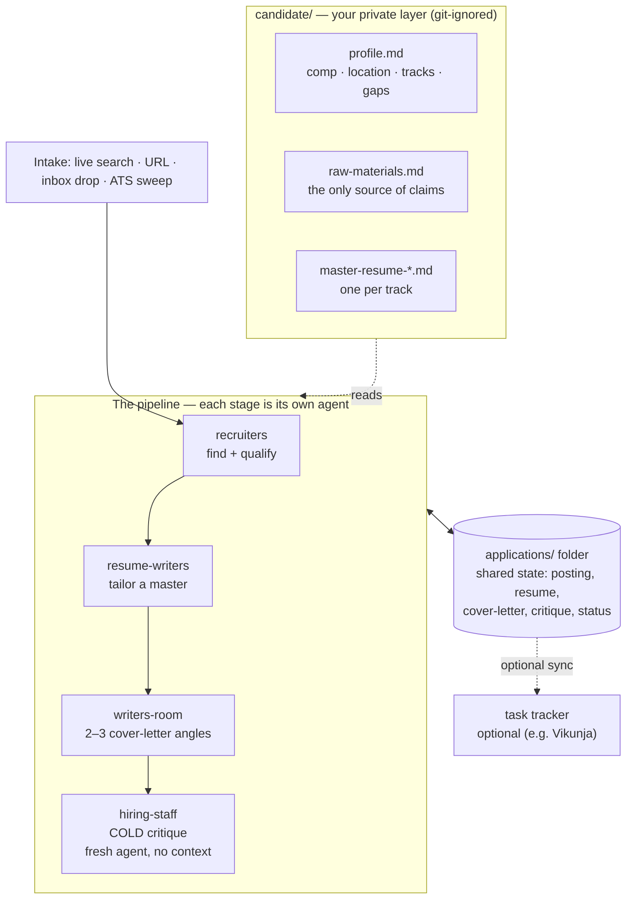

# Job Search, run as a recruiting department

A portable workflow for running your own job search as a set of cooperating AI agent roles,
instead of one chat that tries to do everything. Four "departments" each own a job and a
plain-Markdown brief the agent reads in full:

- **recruiters** — find and qualify openings
- **resume-writers** — tailor a master resume to one posting
- **writers-room** — draft cover letters in two or three genuinely different angles
- **hiring-staff** — critique the finished package **cold**, the way a real screener would

An orchestrator (any capable model — Claude Code, a local model, a plain chat window) routes
work by pointing an agent at the right department's `Context.md`. Nothing depends on a
specific tool or harness.

Everything about *you* lives in a git-ignored `candidate/` layer. The repo ships only the
system plus empty `candidate.example/` scaffolds, so it is safe to fork and share.

---

## How it fits together



**Solid arrows** are the pipeline flow; **dashed** are reads-from / optional. Every request is
routed by `CLAUDE.md`, which also enforces the hard rules across all four stages. The one rule
the diagram is built around: **hiring-staff runs cold** — a fresh agent that never saw the
package get written, so its ninety-second verdict is the real screener's, not a co-author's.

---

## Set it up for yourself

**You need:** git, an AI coding agent or chat model you can point at a folder, and
(optional) Python 3 for the task-tracker sync. No build step, no dependencies.

### 1. Get the repo

```
git clone <your-fork-url> job-search
cd job-search
```

### 2. Create your private layer

```
cp -r candidate.example candidate
```

`candidate/` is git-ignored — it never gets committed. Fill it in, in this order:

1. **`candidate/profile.md`** — do this first. It is the single "env-like" config for the
   whole system: your name and location, comp floor and target, the commute radius, your
   track(s), the titles and industries you want and the ones you refuse, your dealbreakers,
   your house style, and your honest known gaps. Every department reads it. Leave a field as
   `[BRACKETED CAPS]` if you do not know it yet — the agents will treat it as unconstrained
   and say so, rather than guessing.
2. **`candidate/raw-materials.md`** — your real projects and career narrative. This is the
   *only* source the resume writers may draw claims from, so write generously and specifically.
   Under-reporting here is the main way real experience goes missing from your applications.
3. **`candidate/master-resume-*.md`** — one complete, generic master resume per track. The
   resume writers tailor *from* these; they never invent.

### 3. (Optional) connect a task tracker

If you use [Vikunja](https://vikunja.io/), copy the env file and paste your details:

```
cp .env.example .env      # then set VIKUNJA_URL and VIKUNJA_TOKEN
```

Each processed opportunity then syncs to a task with the posting link and files attached.
Leave `.env` unset and everything still works — the sync just skips. Not a Vikunja user? The
sync is one optional script; the whole pipeline runs without it.

### 4. Run it

Point your agent at the repo and ask in plain language:

- *"Find me jobs"* — or paste a posting, or drop one in `recruiters/inbox/`
- *"Tailor my resume for `<posting>`"*
- *"Write a cover letter for `<posting>`"*
- *"How does this package look?"* — runs the cold critique
- *"Run the whole pipeline on `<posting>`"*
- *"Where does the search stand?"* — reads `applications/_index/log.md`

The agent creates one folder per opportunity under `applications/` and moves it through the
pipeline. Those folders and the catalog are git-ignored too.

---

## Why it is built this way

The design decisions are the point, and they are worth stealing:

- **Role separation with hard boundaries** — the critic is a different agent than the writer.
- **Cold isolation** — the hiring-staff critique runs in a fresh agent with no memory of how
  the package was made, or it rubber-stamps its own work.
- **Two kinds of review, priced differently** — a cheap screener simulation after every
  revision, an expensive source audit once per package. Don't pay model cost for the wrong one.
- **Mechanical vs. model routing** — em-dash counts, format parity, and number consistency are
  grep problems, not agent work.
- **One source of truth** — facts live in `candidate/raw-materials.md` and get written back,
  never scattered across folders and forgotten.
- **Anti-fabrication hard rules** — enforced in every brief. Never invent metrics, employers,
  dates, or outcomes.
- **Portable by rule** — every instruction has a fallback; tool integrations are always
  optional and described as one option, never the only one.

---

## Try it? I'd love your feedback

This started as one person's real search and became a system worth sharing. If you set it up,
I genuinely want to hear how it went:

- **What worked, and what you had to change** for your field, seniority, or region — the
  briefs lean toward software engineering, and I'd like to know where that assumption leaks.
- **Where an agent went off the rails** — a brief that was ambiguous, a rule it ignored, a
  step that needed hand-holding.
- **What you added** — a new intake door, a different tracker, a fifth department.

Open an issue or a discussion on the repo. Bug reports, "this brief confused my model,"
and "here's a better way to phrase rule 3" are all welcome. PRs that keep the portability
rule (no harness-specific magic, every tool optional) are especially welcome.

---

## The hard rules (see `CLAUDE.md`)

Never fabricate. No unprovable outcome claims. Redact employer internals and client names.
Flag unknowns as `[BRACKETED CAPS]`. These are load-bearing — breaking them costs real
opportunities.
